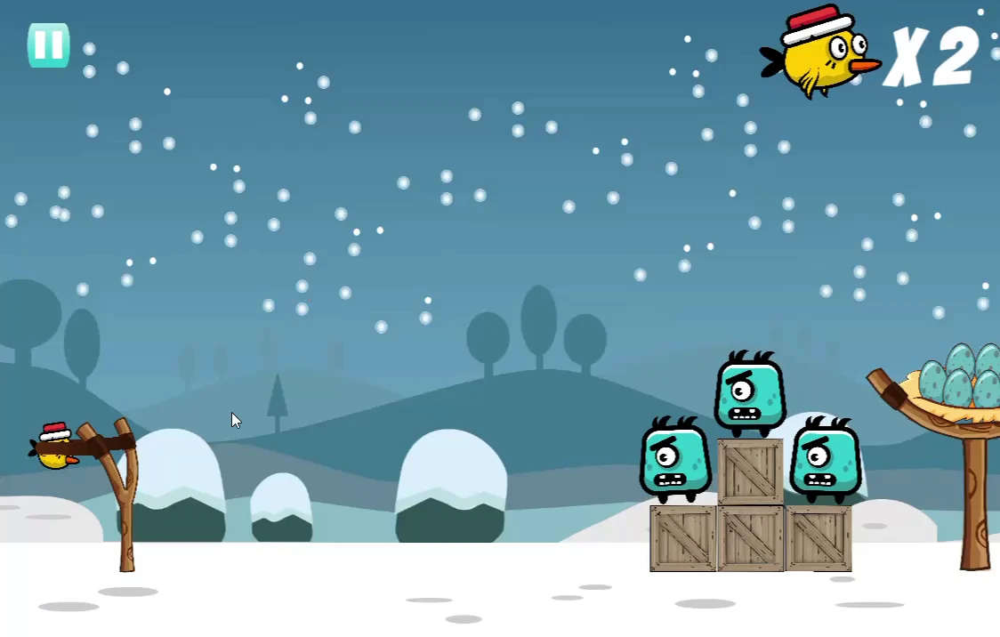

# Egg Hunt

Egg Hunt is a Unity slingshot physics game built for mobile play. It has 60 levels and a level menu, with each level combining a limited number of launches, physics obstacles and targets.

## What it does

- Converts the drag distance and direction into a force on a `Rigidbody2D` when the player releases the projectile.
- Clamps the drag position around the slingshot and draws both bands with line renderers.
- Spawns a limited number of projectiles, updates the remaining count and follows the active projectile with the camera.
- Provides 60 scene-based levels and stores unlocked progress with `PlayerPrefs`.
- Detects when every target is removed, moves the character to the eggs and opens the level-complete screen.
- Includes pause, restart, next-level and separate music and effects volume controls.

## Stack

- Unity 2020.3.11f1
- C#
- Unity 2D physics, animation, UI and TextMesh Pro

## Run it locally

1. Install Unity Editor `2020.3.11f1` through Unity Hub.
2. Clone this repository and add its folder as a Unity project.
3. Import TextMesh Pro Essential Resources and Examples & Extras when Unity prompts you. Two menu font references use those re-importable package assets.
4. Open `Assets/Scenes/Home Screen.unity` and press Play.

The public copy keeps the scripts, scenes and Unity references, but replaces the original visual and audio assets with neutral placeholders.

## Gameplay

https://github.com/user-attachments/assets/d6f9ee4c-5d69-4a02-bca5-10034e3b7d84

## Credits

Built by Ghaleb Mohiuddin Syed. The title image comes from the Egg Hunt showcase archive. Neutral placeholder sprites and silent audio keep the Unity references intact in this public copy.

## Licence

The source code is available under the [MIT Licence](LICENSE). The title image is not covered by the licence.
